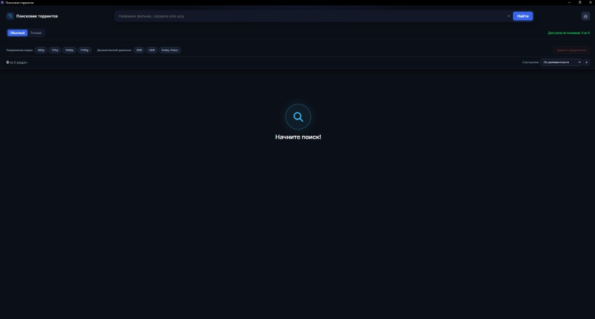
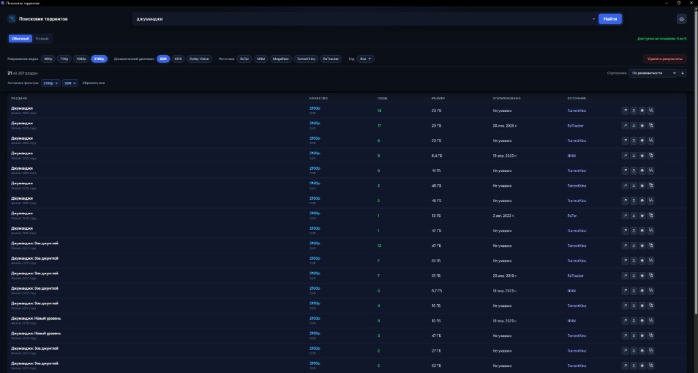
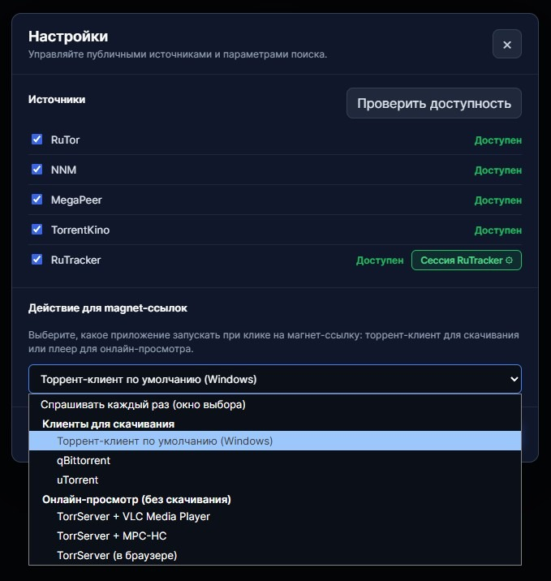

# Поисковик торрентов

Настольное приложение для Windows 10/11 на базе **Electron**, **React**, **TypeScript** и **Vite**, которое осуществляет быстрый поиск фильмов, сериалов и шоу по открытым и авторизованным русскоязычным каталогам раздач с удобной фильтрацией по качеству, динамическому диапазону и источникам.

---

### 📥 Скачать готовую программу (Portable .exe)

Не требует установки. Просто скачайте файл и запустите:

👉 **[Скачать программу (.exe)](https://github.com/Yura1206/poisk_torrentov/releases/latest/download/Poiskovik_torrentov.exe)**  
*(Все выпуски доступны на странице [Releases](https://github.com/Yura1206/poisk_torrentov/releases))*

> 💡 **Примечание по первому запуску в Windows (SmartScreen):**  
> Так как программа является независимым открытым проектом без коммерческого сертификата разработчика, встроенный фильтр **Microsoft Defender SmartScreen** при первом запуске может показать предупреждение. Это стандартная реакция Windows на новые файлы из сети.  
> Чтобы запустить программу: нажмите кнопку **«Выполнить в любом случае»** (если кнопка скрыта — нажмите ссылку *«Подробнее»*, затем *«Выполнить в любом случае»*). Либо в свойствах файла поставьте галочку *«Разблокировать»*. Windows запомнит выбор и больше спрашивать не будет.

---

## 📸 Скриншоты

### Главный экран


### Результаты поиска и фильтры


### Настройки источников и действия для magnet-ссылок


---

## ✨ Возможности и особенности

Программа функционирует как удобный **агрегатор торрентов**, объединяющий каталоги нескольких независимых трекеров в единую поисковую ленту. Вам больше не нужно открывать десятки вкладок в браузере: приложение параллельно опрашивает открытые и авторизованные базы, собирает актуальные релизы, проверяет доступность сидов и автоматически приводит технические характеристики к единому стандарту.

### Поддержка популярных трекеров:
- **RuTor:** открытый поиск, раздачи с пирами, magnet-ссылками и загрузкой `.torrent`.
- **NNM (NoNameClub):** открытый поиск, раздачи с прямыми ссылками на `.torrent`.
- **MegaPeer:** открытый трекер с актуальными релизами, пирами и скачиванием `.torrent`.
- **TorrentKino:** быстрый поиск с прямыми ссылками и пирами.
- **RuTracker:** поиск с поддержкой авторизации (вход через встроенное окно браузера с автосохранением сессии или ручной ввод Cookie).

### Режимы и фильтрация:
Встроенный **поиск торрентов** поддерживает как гибкий поиск по ключевым словам, так и строгий консервативный режим, сопоставляющий точное название фильма (что исключает показ продолжений или приквелов, если вы ищете конкретную часть). Результаты можно мгновенно фильтровать по разрешению видео (от 480p до 4K 2160p) и динамическому диапазону (SDR, HDR, Dolby Vision) прямо на лету без повторных обращений к сети.

### Другие возможности:
- **Современный стек:** Electron + React 19 + TypeScript + Vite; изолированный контекст безопасности (`contextIsolation: true`, `nodeIntegration: false`) и типизированный IPC.
- **Умная нормализация метаданных:** определение года, типа контента, сезона, разрешения (480p, 720p, 1080p, 2160p 4K), динамического диапазона (SDR, HDR, HDR10, Dolby Vision), размера, сидов и личеров.
- **Интеграция с торрент-клиентами и плеерами:**
  - Запуск через системный торрент-клиент по умолчанию.
  - Прямой запуск в qBittorrent, uTorrent.
  - Онлайн-просмотр без предварительного скачивания через **TorrServer** (в связке с VLC, MPC-HC или в браузере).
- **Мгновенная локальная фильтрация и сортировка:** фильтры по разрешению, диапазону и источникам работают мгновенно без повторных запросов в сеть.
- **Безопасность данных:** настройки, история поисков и сессии хранятся локально в системном профиле пользователя Windows (`%APPDATA%`).

---

## 🚀 Установка и запуск для разработки

Требуется **Node.js 20+** и **npm**.

```powershell
# Установка зависимостей
npm install

# Запуск в режиме разработки (Vite + Electron)
npm run dev
```

---

## 🛠️ Проверка и сборка

```powershell
# Проверка типов TypeScript
npm run typecheck

# Запуск тестов
npm test

# Сборка проекта
npm run build

# Создание готового Portable .exe
npm run dist
```

После выполнения `npm run dist` готовый файл программы будет сохранён в папке `release/`.

### Сборка в один клик
В корне репозитория есть готовый скрипт для Windows:
- `build-portable.bat` — автоматически проверяет окружение, компилирует приложение и открывает папку с собранным файлом.

---

## ⚖️ Лицензия

Проект распространяется под лицензией [MIT](LICENSE).

---

## ℹ️ Источники и правовая информация

Приложение работает с публичными веб-страницами и открытыми данными индексаторов. Метаданные (названия, сиды, размеры) предоставляются источниками as-is. Пользователь несёт личную ответственность за соблюдение правил трекеров и законодательства своей юрисдикции при скачивании материалов.
